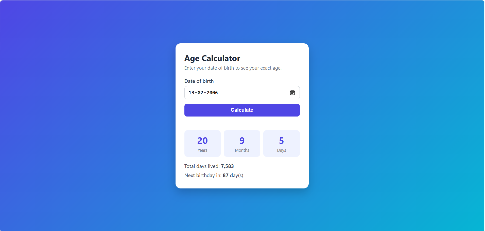

# Age Calculator

A simple age calculator built with HTML, CSS and vanilla JavaScript. Enter your date of birth and it shows your exact age in years, months and days, the total days you have lived, and how many days remain until your next birthday.

## Tech used
- HTML5
- CSS3
- JavaScript (no frameworks, no libraries, no API keys)

## How to run locally
1. Clone the repository and open this folder: `AgeCalculator/<your-username>`
2. Open `index.html` in any browser. No install or build step needed.

## Features
- Exact age in years, months and days
- Total days lived
- Days until next birthday
- Validation for empty and future dates
- Responsive layout

## Screenshot

