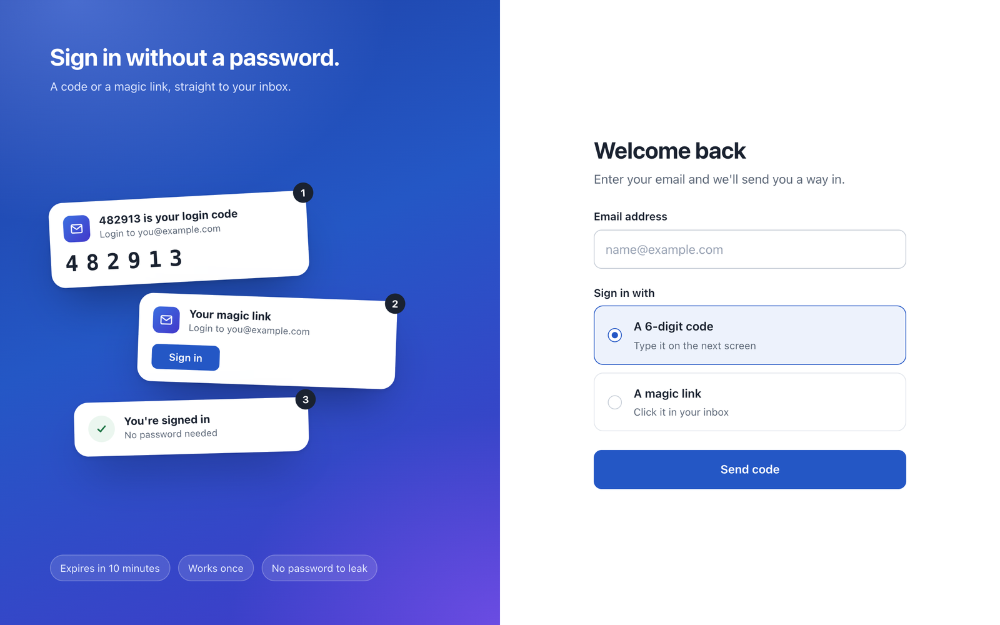

# Passwordless Login with Email OTP and Magic Link (Express)

Users enter their email and sign in with a 6-digit code or a magic link, with no password. Codes and links are hashed, single use, expire after 10 minutes and are rate limited.

Source and full documentation: https://github.com/parv15/express-email-otp-login

## Built with

- Node.js 20+, Express 5
- TypeScript
- SQLite (better-sqlite3)
- Zod for request validation
- Vitest for tests
- Mailtrap Email API for sending the login emails

## Run it locally

```bash
git clone https://github.com/parv15/express-email-otp-login.git && cd express-email-otp-login
npm install
cp .env.example .env
npm run user:add -- you@example.com
npm run dev
```

Set `MAILTRAP_TOKEN`, `MAIL_FROM_EMAIL` and `OTP_SECRET` in `.env` first. Generate the secret with:

```bash
node -e "console.log(require('crypto').randomBytes(48).toString('base64url'))"
```

Then open http://localhost:3000/login.

## API key

Create a free Mailtrap account, verify a sending domain, and create an API token for the Email API (Transactional stream). Put it in `MAILTRAP_TOKEN`.

## Screenshot


