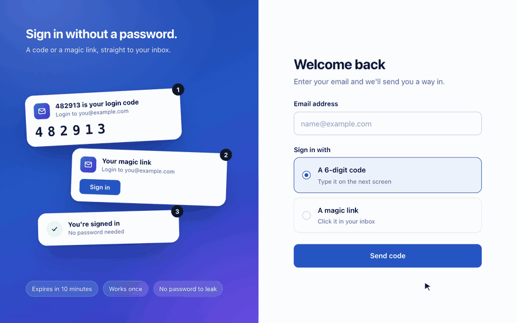
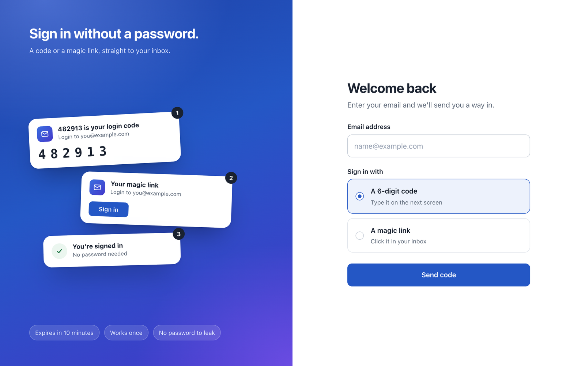

# Passwordless Login (Express, email code and magic link)

A passwordless login for Node.js apps. Users enter their email and sign in with a **6-digit code** or a **magic link**. Codes and links are hashed, single-use and expire after 10 minutes, a code locks after 5 wrong attempts, and requests are rate limited. Login emails are sent with the Mailtrap Email API.





## Tech stack

- **Language:** TypeScript (strict mode), Node.js 20 or newer
- **Server:** Express 5, with server-rendered HTML (no frontend framework)
- **Database:** SQLite through `better-sqlite3`
- **Validation:** Zod (environment variables and form input)
- **Email:** the official `mailtrap` SDK (Transactional stream)
- **Tests:** Vitest and Supertest, with a fake mailer and a fake clock

## Run it locally

```bash
cd PasswordlessLogin/manishgupta412
npm install
cp .env.example .env
```

Fill in `.env` (see the next section), then:

```bash
npm run user:add -- you@example.com   # needed while AUTO_SIGNUP=false
npm run dev                           # http://localhost:3000/login
```

Run the tests (no Mailtrap account needed):

```bash
npm test
npm run typecheck
```

## Getting the API key

1. Create a free account at https://mailtrap.io.
2. Go to **Settings, API Tokens** and create a token with access to your sending domain.
3. Put it in `.env` as `MAILTRAP_TOKEN`.
4. Set `MAIL_FROM_EMAIL` to an address on a domain you verified in Mailtrap. For a first try, use `hello@demomailtrap.co` and sign in with your own Mailtrap account email, because the demo domain only delivers to the account owner.
5. Generate the HMAC key for `OTP_SECRET`:

   ```bash
   node -e "console.log(require('crypto').randomBytes(48).toString('base64url'))"
   ```

## Features

- Choose a 6-digit code or a magic link on the login page
- Only the chosen credential is generated, emailed and stored, as an HMAC-SHA256 hash
- Single-use, 10-minute expiry, lock after 5 wrong codes, 60-second resend cooldown with a live timer
- Magic links only show a button on `GET`, so email scanners cannot use them up
- The same page, status and response time for known and unknown emails, so accounts cannot be enumerated
- Hashed server-side sessions, and logs that never contain codes, tokens or links

## Live demo

Not hosted, because it needs a Mailtrap account to send email. The GIF above is a recording of a local run.

Full documentation, flow diagram and security notes: https://github.com/manishgupta412/express-email-otp-login
