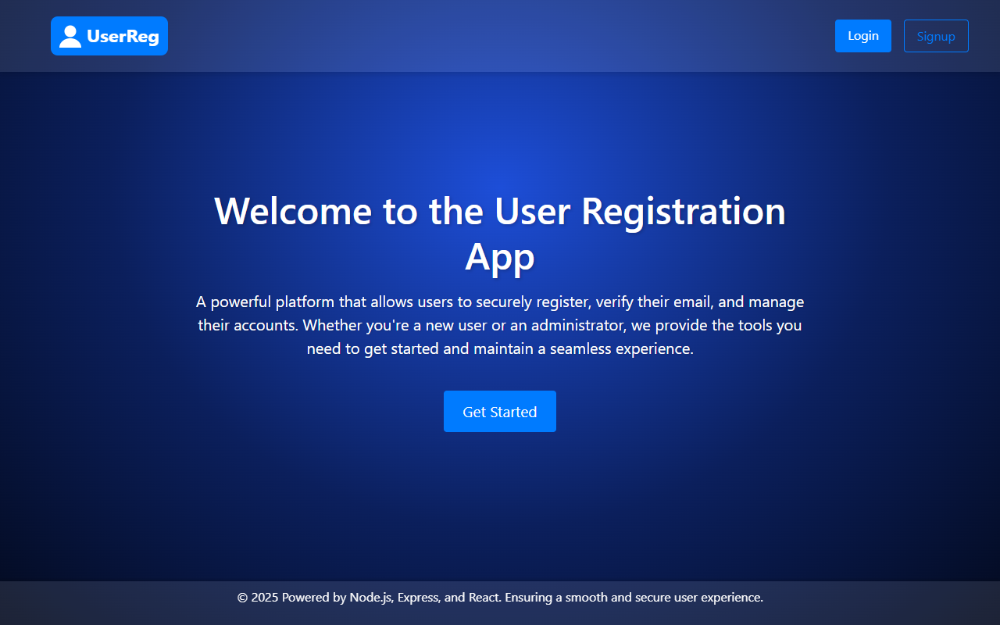
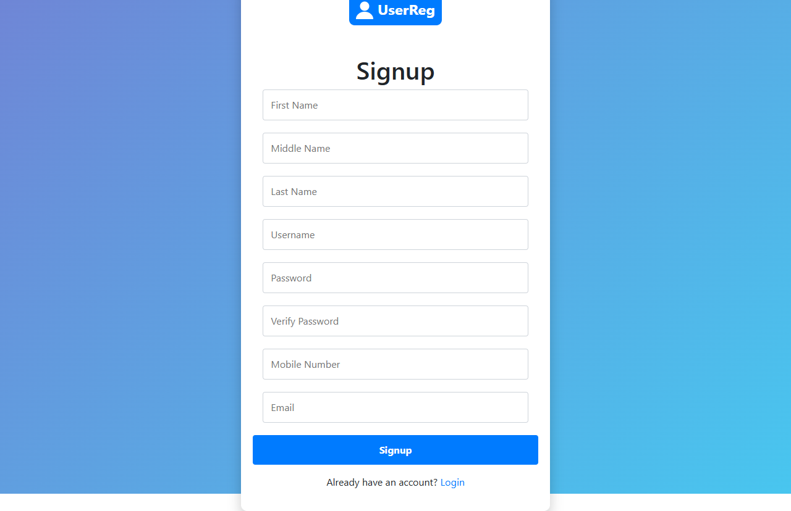
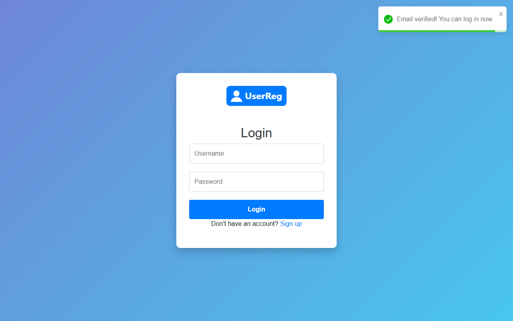
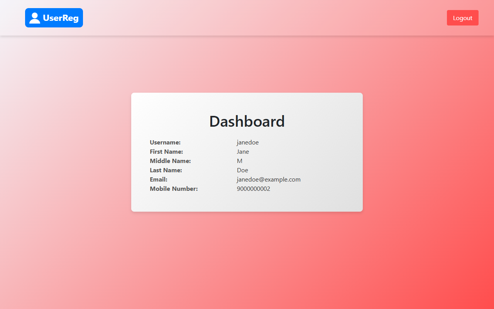
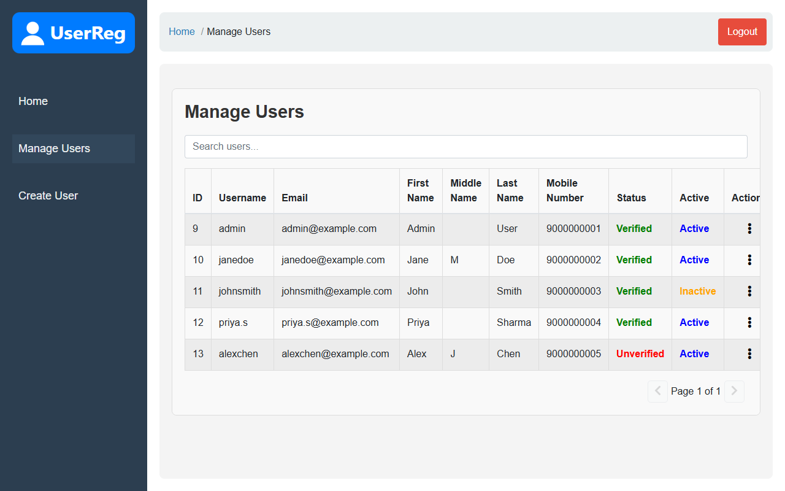
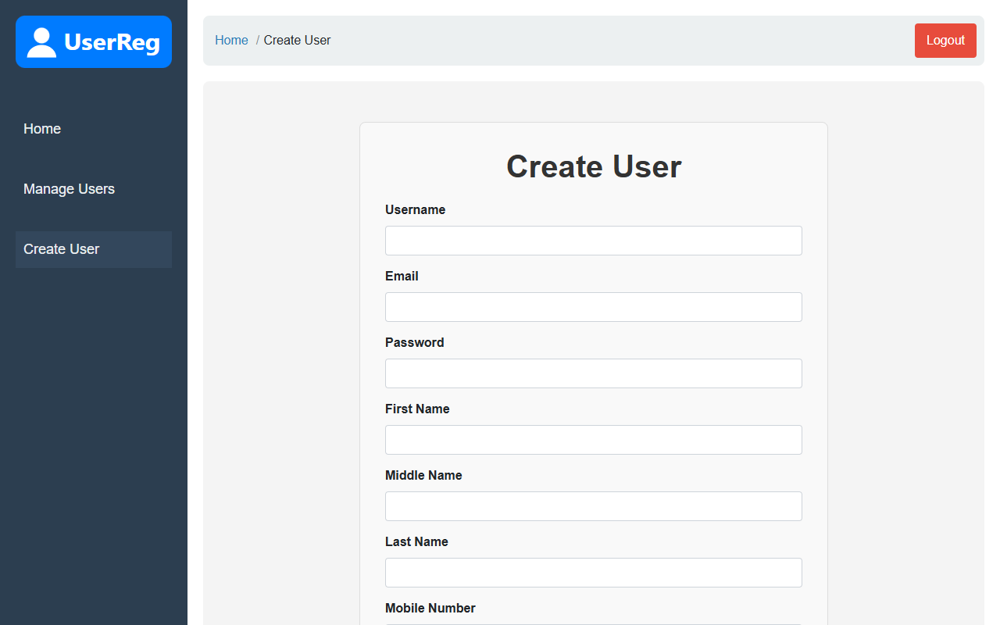
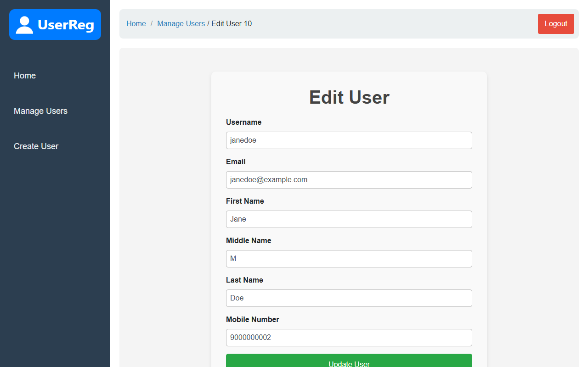

# 🔐 User Registration App

<div align="center">



**A comprehensive Node.js user registration system with admin dashboard and email verification**

[](https://nodejs.org/)
[](https://expressjs.com/)
[](https://reactjs.org/)
[](https://mysql.com/)
[](https://developer.mozilla.org/en-US/docs/Web/JavaScript)
[](https://www.w3.org/Style/CSS/Overview.en.html)

</div>

---

## 📖 Overview

This is a full-stack Node.js application that provides a complete user registration system with email verification and an administrative dashboard. The application offers secure user management capabilities, allowing both regular users to register and authenticate, while providing administrators with comprehensive user management tools.

### 🎯 Key Capabilities

The application ensures secure user management and provides a seamless experience for both regular users and administrators through:

- **User Registration & Authentication** - Complete signup and login workflow
- **Email Verification System** - Automated email verification using Nodemailer
- **Administrative Dashboard** - Comprehensive user management interface
- **CRUD Operations** - Full create, read, update, and delete functionality
- **User Status Management** - Activate/deactivate user accounts

---

## 📋 Table of Contents

- [🚀 Features](#-features)
- [📸 Screenshots](#-screenshots)
- [🛠️ Tech Stack](#️-tech-stack)
- [📁 Project Structure](#-project-structure)
- [⚙️ Setup](#️-setup)
- [🔧 Installation](#-installation)
- [🛣️ Routes Overview](#️-routes-overview)
- [📄 License](#-license)
- [🤝 Contributing](#-contributing)
- [📞 Contact](#-contact)

---

## 🚀 Features

<table>
<tr>
<td width="50%">

### 👥 User Features
- ✅ **User Registration** - Secure account creation
- ✅ **Email Verification** - Automated verification emails
- ✅ **User Authentication** - Login/logout functionality
- ✅ **User Dashboard** - Personal account interface

</td>
<td width="50%">

### 👨‍💼 Admin Features
- ✅ **Admin Dashboard** - Comprehensive management interface
- ✅ **User Management** - Create, edit, delete users
- ✅ **Account Control** - Activate/deactivate accounts
- ✅ **User Overview** - View all registered users

</td>
</tr>
</table>

---

## 📸 Screenshots

| Sign up | Login (after verifying the email) |
|---|---|
|  |  |
| **User dashboard** | **Admin: manage users** |
|  |  |
| **Admin: create user** | **Admin: edit user** |
|  |  |

---

## 🛠️ Tech Stack

<div align="center">

### Backend


### Frontend


### Database & Tools


</div>

---

## 📁 Project Structure

<details>
<summary>🔍 Click to expand project structure</summary>

```
📦 UserRegistration
├── 📁 backend/
│   ├── 📁 config/
│   │   └── 📄 db.js                     # MySQL database connection
│   ├── 📁 middleware/
│   │   ├── 📄 isAdmin.js                # Admin verification middleware
│   │   └── 📄 requireLogin.js           # Session check middleware
│   ├── 📁 routes/
│   │   ├── 📄 admin.js                  # Admin dashboard routes
│   │   ├── 📄 dashboard.js              # User dashboard routes
│   │   ├── 📄 home.js                   # Home page routes
│   │   ├── 📄 login.js                  # Authentication routes
│   │   ├── 📄 logout.js                 # Session management
│   │   └── 📄 signup.js                 # User registration routes
│   ├── 📁 services/
│   │   ├── 📄 emailService.js           # Email sending service
│   │   └── 📄 password.js               # Salted password hashing (scrypt)
│   ├── 📄 .env                          # Environment variables (create from .env.example)
│   ├── 📄 .env.example                  # Environment template
│   └── 📄 server.js                     # Main server file
│
└── 📁 frontend/
    ├── 📁 src/
    │   ├── 📄 App.jsx                   # Main React component
    │   ├── 📄 main.jsx                  # React entry point
    │   ├── 📁 components/
    │   │   ├── 📁 AdminNavbar/
    │   │   │   ├── 📄 AdminNavbar.css
    │   │   │   └── 📄 AdminNavbar.jsx
    │   │   ├── 📁 AdminSidebar/
    │   │   │   ├── 📄 AdminSidebar.css
    │   │   │   └── 📄 AdminSidebar.jsx
    │   │   └── 📁 Navbar/
    │   │       ├── 📄 Navbar.css
    │   │       └── 📄 Navbar.jsx
    │   ├── 📁 pages/
    │   │   ├── 📄 Admin.jsx             # Admin dashboard
    │   │   ├── 📄 CreateUser.jsx        # User creation
    │   │   ├── 📄 Dashboard.jsx         # User dashboard
    │   │   ├── 📄 EditUser.jsx          # User editing
    │   │   ├── 📄 Home.jsx              # Landing page
    │   │   ├── 📄 Login.jsx             # Authentication
    │   │   ├── 📄 ManageUsers.jsx       # User management
    │   │   └── 📄 Signup.jsx            # Registration
    │   └── 📁 styles/
    │       ├── 📄 Admin.css
    │       ├── 📄 CreateUser.css
    │       ├── 📄 Dashboard.css
    │       ├── 📄 EditUser.css
    │       ├── 📄 Home.css
    │       ├── 📄 Login.css
    │       ├── 📄 ManageUsers.css
    │       └── 📄 Signup.css
    ├── 📁 public/
    ├── 📄 index.html
    ├── 📄 package.json
    └── 📄 vite.config.js
```

</details>

---

## ⚙️ Setup

### 📋 Prerequisites

Before you begin, ensure you have the following installed:

| Requirement | Version | Description |
|-------------|---------|-------------|
|  | 18.x or above | JavaScript runtime |
|  | Latest | Database server |
|  | Latest | Version control |
|  | Latest | Frontend framework |

---

## 🔧 Installation

### 🖥️ Backend Setup

<details>
<summary>📥 Step 1: Clone the Repository</summary>

```bash
git clone https://github.com/AadityaPanda/UserRegistration.git
cd UserRegistration/backend
```

</details>

<details>
<summary>📦 Step 2: Install Dependencies</summary>

```bash
npm install
```

</details>

<details>
<summary>🔧 Step 3: Environment Configuration</summary>

Create your environment file:
```bash
cp .env.example .env
```

Configure your `.env` file with the following variables:

```env
# 🗄️ Database Configuration
DB_HOST=your_database_host
DB_USER=your_database_user
DB_PASSWORD=your_database_password
DB_NAME=your_database_name

# 🔐 Session Configuration
SESSION_SECRET=your_session_secret

# 🌐 Server Configuration
PORT=3000
BASE_URL=http://localhost:3000        # backend URL, used in the verification email link
FRONTEND_URL=http://localhost:5173    # frontend URL, for CORS and the redirect after email verification

# 📧 SMTP Configuration (in development you can leave SMTP_HOST empty: the verification link is then printed in the backend console)
SMTP_HOST=your_smtp_host
SMTP_PORT=587
EMAIL_USER=your_email_address
EMAIL_PASS=your_email_password
SMTP_SECURE=false
```

</details>

### 🗄️ Database Setup

<details>
<summary>📊 Step 4: Database Configuration</summary>

Execute the following SQL commands to set up your database:

```sql
-- Create the database
CREATE DATABASE myform;

-- Switch to the database
USE myform;

-- Create the users table
CREATE TABLE users (
    id INT UNSIGNED AUTO_INCREMENT PRIMARY KEY,
    firstname VARCHAR(30) NOT NULL,
    middlename VARCHAR(30),
    lastname VARCHAR(30) NOT NULL,
    username VARCHAR(50) NOT NULL UNIQUE,
    password VARCHAR(255) NOT NULL,
    mobile_no VARCHAR(15) NOT NULL,
    email VARCHAR(50) NOT NULL UNIQUE,
    isAdmin BOOLEAN DEFAULT FALSE,
    verified BOOLEAN DEFAULT FALSE,
    active BOOLEAN DEFAULT TRUE,
    token VARCHAR(64),
    expires_at DATETIME
);
```

**Create an admin:** start the app, sign up with the username `admin` and verify the email, then run:
```sql
UPDATE users SET isAdmin = TRUE WHERE username = 'admin';
```

</details>

<details>
<summary>🚀 Step 5: Start the Backend Server</summary>

```bash
npm start        # or: npm run dev (auto-restart with nodemon)
```

✅ Backend server will be running at `http://localhost:3000`

</details>

### 🎨 Frontend Setup

<details>
<summary>⚛️ Step 1: Go to the Frontend Folder</summary>

From the project root:
```bash
cd frontend
```

</details>

<details>
<summary>📦 Step 2: Install Frontend Dependencies</summary>

```bash
npm install
```

</details>

<details>
<summary>🏗️ Step 3: Run</summary>

```bash
npm run dev
```

✅ Frontend will be running at `http://localhost:5173`

</details>

---

## 🛣️ Routes Overview

<table>
<thead>
<tr>
<th>🌐 Route</th>
<th>📝 Description</th>
<th>🔒 Access</th>
</tr>
</thead>
<tbody>
<tr>
<td><code>/</code></td>
<td>🏠 Landing page</td>
<td>🌍 Public</td>
</tr>
<tr>
<td><code>/signup</code></td>
<td>📝 User registration</td>
<td>🌍 Public</td>
</tr>
<tr>
<td><code>/login</code></td>
<td>🔐 User authentication</td>
<td>🌍 Public</td>
</tr>
<tr>
<td><code>/dashboard</code></td>
<td>👤 User dashboard</td>
<td>🔒 Authenticated</td>
</tr>
<tr>
<td><code>/admin</code></td>
<td>👨‍💼 Admin homepage</td>
<td>🛡️ Admin only</td>
</tr>
<tr>
<td><code>/admin/user</code></td>
<td>👥 User management</td>
<td>🛡️ Admin only</td>
</tr>
<tr>
<td><code>/admin/create</code></td>
<td>➕ Create new user</td>
<td>🛡️ Admin only</td>
</tr>
<tr>
<td><code>/admin/edit/:id</code></td>
<td>✏️ Edit user details</td>
<td>🛡️ Admin only</td>
</tr>
</tbody>
</table>

---

## 📄 License

<div align="center">

[](https://choosealicense.com/licenses/mit/)

**This project is licensed under the MIT License**

Feel free to use, modify, and distribute it in your projects.

</div>

---

## 🤝 Contributing

We welcome contributions! Here's how you can help improve this project:

### 🔧 Development Workflow

1. **🍴 Fork the repository**
2. **🌿 Create a feature branch**
   ```bash
   git checkout -b feature/YourFeatureName
   ```
3. **💾 Commit your changes**
   ```bash
   git commit -m "Add YourFeatureName"
   ```
4. **📤 Push to the branch**
   ```bash
   git push origin feature/YourFeatureName
   ```
5. **🔄 Open a pull request**

### 📋 Contribution Guidelines

- 🧪 Ensure all tests pass before submitting
- 📝 Update documentation for new features
- 🎨 Follow the existing code style
- 💬 Provide clear commit messages

Check [CONTRIBUTING.md](CONTRIBUTING.md) for detailed guidelines.

---

## 📞 Contact

<div align="center">

**👨‍💻 Aaditya Panda**

[](mailto:aadityapanda23@gmail.com)
[](https://github.com/AadityaPanda)

---

<sub>💝 **Thank you for using the User Registration App!**</sub>

*If you found this project helpful, please consider giving it a ⭐ on GitHub!*

</div>
